# ER Diagram – Gym Management System

## 1. Overview

This document defines the Entity Relationship Diagram (ERD) for the Gym Management System.

The ERD represents:

- Database entities.
- Primary keys (PK).
- Foreign keys (FK).
- Relationships between tables.
- One-to-one relationships.
- One-to-many relationships.
- Many-to-many relationships.

### Database Technology

- Database: PostgreSQL
- Primary Key: UUID
- Relationships: Foreign Keys
- Diagram Format: Mermaid ER Diagram

### Relationship Notation

| Symbol | Meaning |
|---|---|
| `||` | Exactly one |
| `o|` | Zero or one |
| `|{` | One or more |
| `o{` | Zero or more |

---

# 2. Complete Database Entity Overview

The following diagram shows the major modules and their relationships.

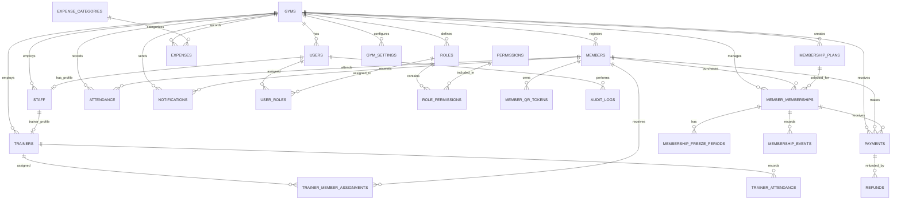

---

# 3. Gym and Authentication Relationships

This section represents gym information, application users and staff records.

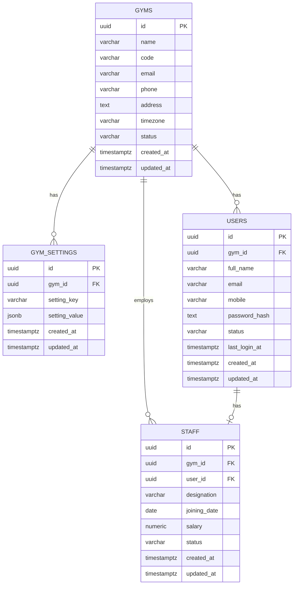

### Relationship Explanation

- One gym can have multiple users.
- One gym can employ multiple staff members.
- One user can have zero or one staff profile.
- One gym can have multiple settings.

---

# 4. Dynamic RBAC Relationships

This section represents the complete dynamic Role-Based Access Control system.

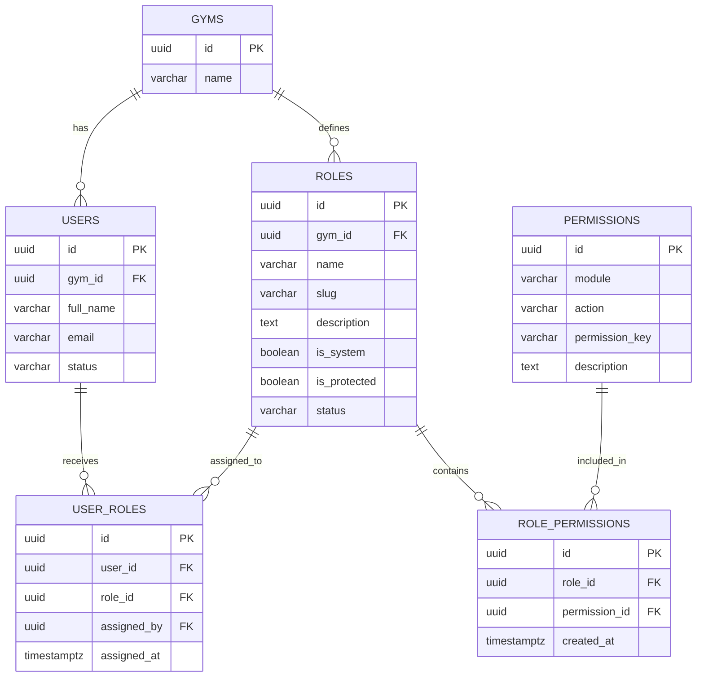

### Relationship Explanation

- One gym can create multiple custom roles.
- One user can have multiple roles.
- One role can be assigned to multiple users.
- One role can contain multiple permissions.
- One permission can belong to multiple roles.

This supports dynamic role creation through the Settings page.

Example:

```text
Accountant Role
    |
    +-- dashboard.view
    +-- payments.view
    +-- payments.create
    +-- expenses.view
    +-- expenses.create
    +-- reports.view
    +-- reports.export
```

Permissions are defined by the application and assigned to roles by authorized administrators.

---

# 5. Member Management Relationships

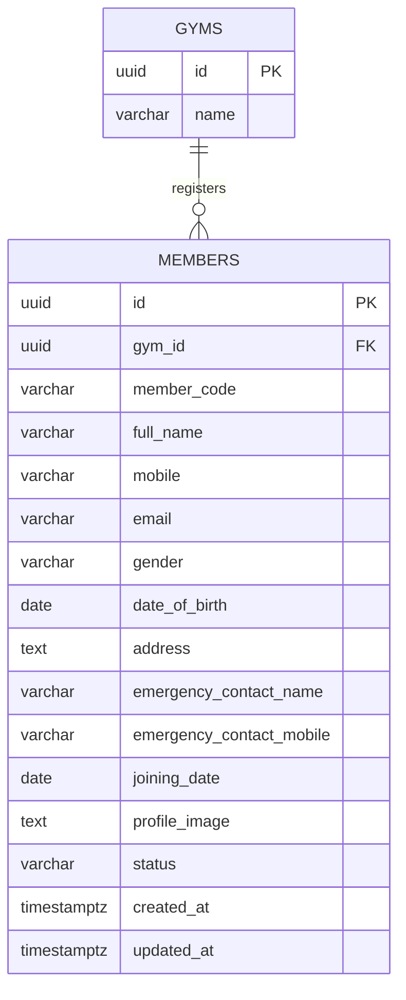

### Relationship Explanation

- One gym can register multiple members.
- Every member belongs to one gym.
- Member records are separate from application login users.

A member does not need an application user account unless member login functionality is introduced later.

---

# 6. Membership Management Relationships

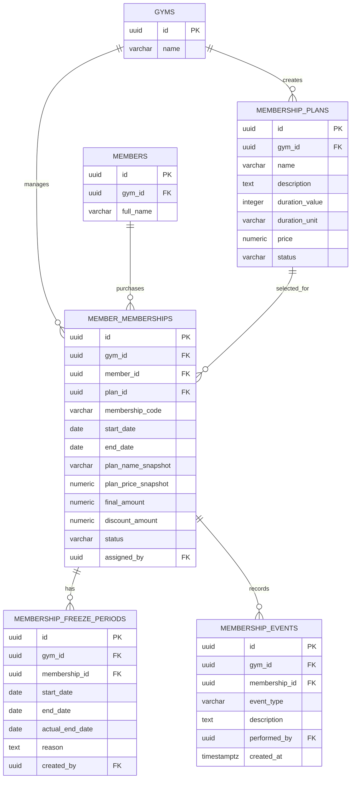

### Relationship Explanation

- One gym can create multiple membership plans.
- One member can purchase multiple memberships over time.
- One membership plan can be used by multiple members.
- One member membership can have multiple freeze periods.
- One member membership can have multiple historical events.

### Important Business Rule

Membership plans and member memberships must remain separate.

Example:

```text
Membership Plan
    Monthly Plan
    Price: ₹1,000
    Duration: 1 Month
          |
          |
          v
Member Membership
    Member: Rahul
    Start Date: 01-11-2026
    End Date: 30-11-2026
    Final Amount: ₹900
    Status: Active
```

The member membership keeps its original price snapshot even if the plan price changes later.

---

# 7. Attendance Management Relationships

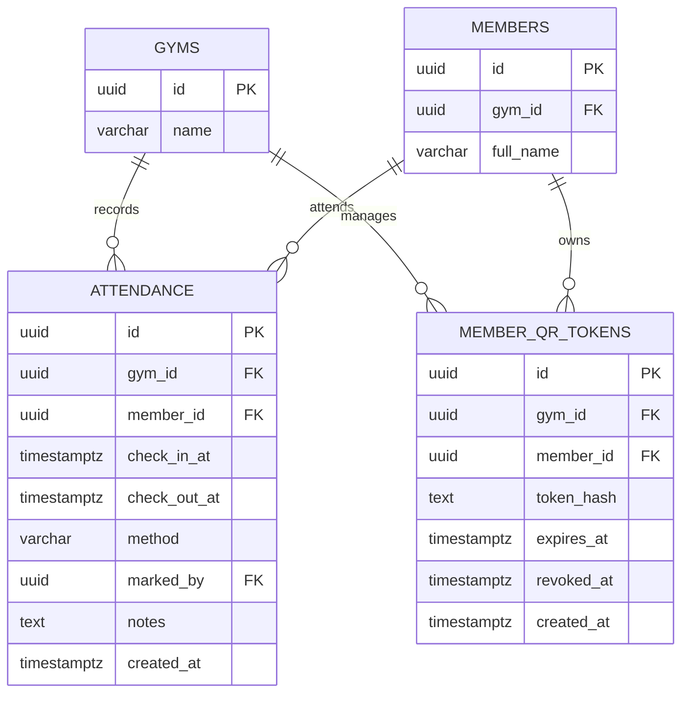

### Relationship Explanation

- One member can have multiple attendance records.
- One member can have multiple QR tokens over time.
- Every attendance record belongs to one gym.
- Attendance can be recorded manually or through QR scanning.

The backend must validate membership eligibility before accepting attendance.

---

# 8. Payment Management Relationships

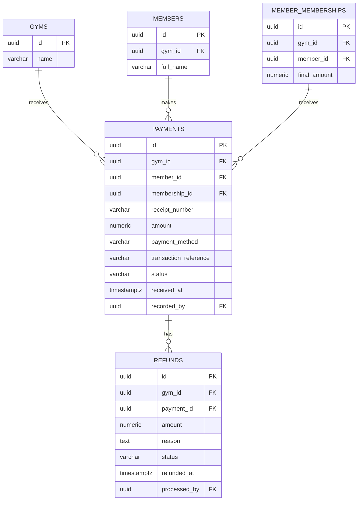

### Relationship Explanation

- One member can make multiple payments.
- One membership can receive multiple partial payments.
- One payment can have multiple refund records, provided their combined successful amount does not exceed the original successful payment.
- Refund records must remain linked to the original payment.

### Example

```text
Membership Amount: ₹3,000
          |
          |
          +---- Payment 1: ₹1,000
          |
          +---- Payment 2: ₹1,000
          |
          +---- Payment 3: ₹1,000
```

Total successful collection: ₹3,000.

---

# 9. Trainer Management Relationships

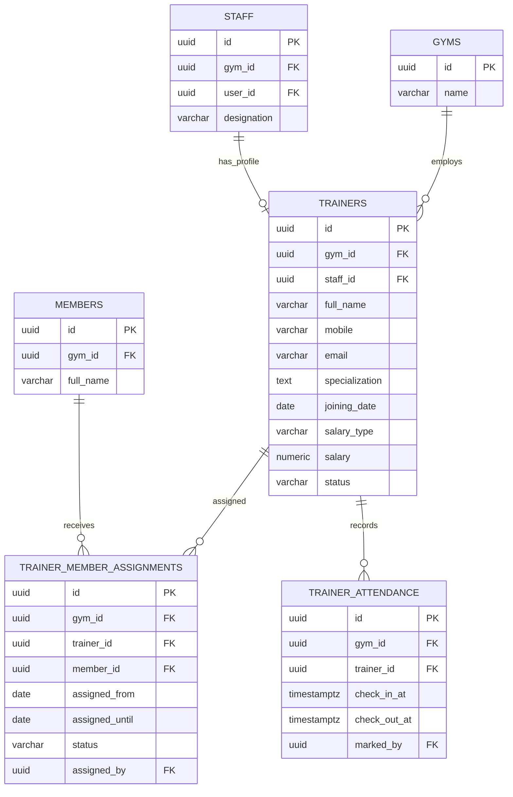

### Relationship Explanation

- A gym can employ multiple trainers.
- A trainer can be connected to a staff profile.
- A trainer can be assigned to multiple members.
- A member can have multiple trainer assignments over time.
- A trainer can have multiple attendance records.

---

# 10. Expense Management Relationships

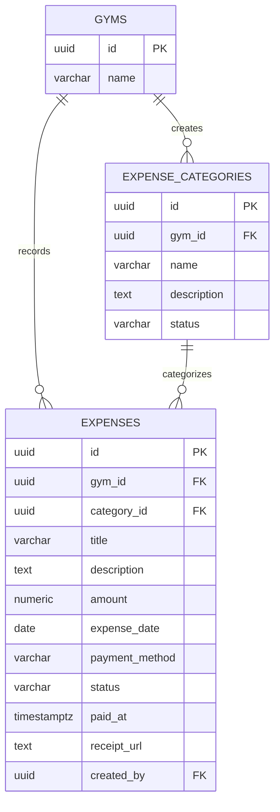

### Relationship Explanation

- One gym can create multiple expense categories.
- One category can contain multiple expenses.
- Every expense belongs to one gym.

---

# 11. Notification Management Relationships

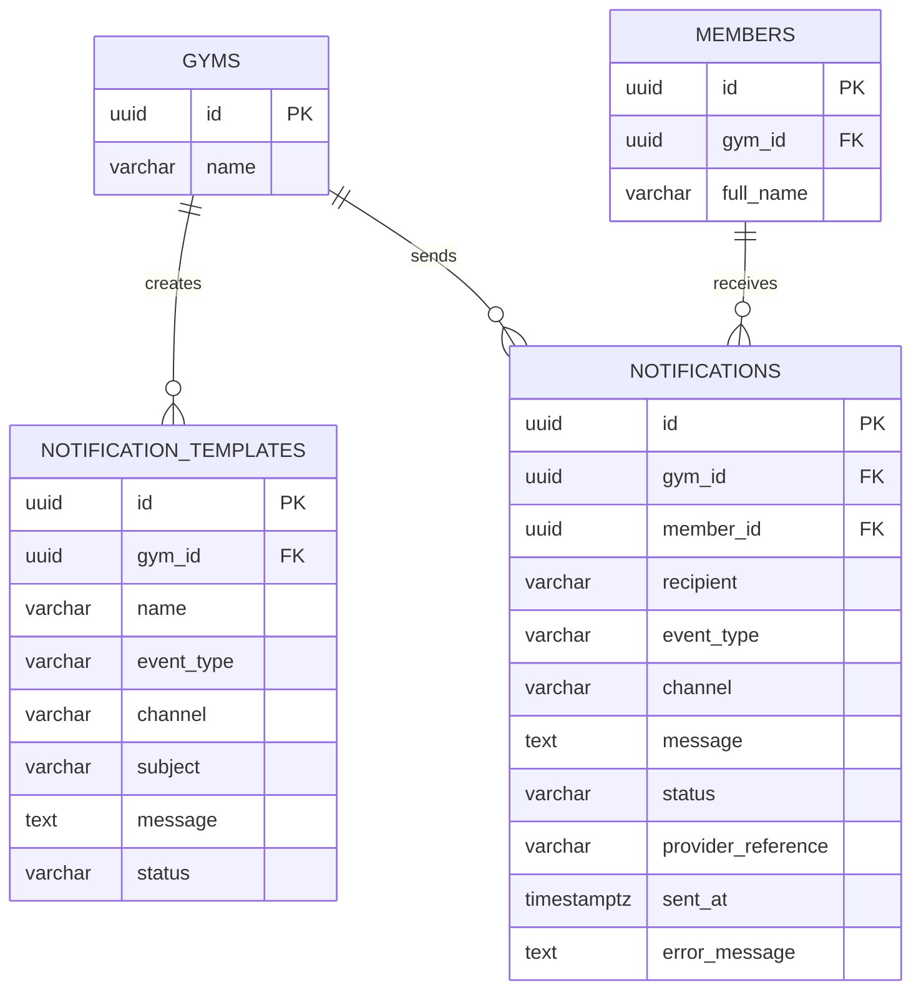

### Relationship Explanation

- One gym can create multiple notification templates.
- One gym can send multiple notifications.
- One member can receive multiple notifications.
- Notifications can be sent through Email or WhatsApp.

---

# 12. Audit Management Relationships

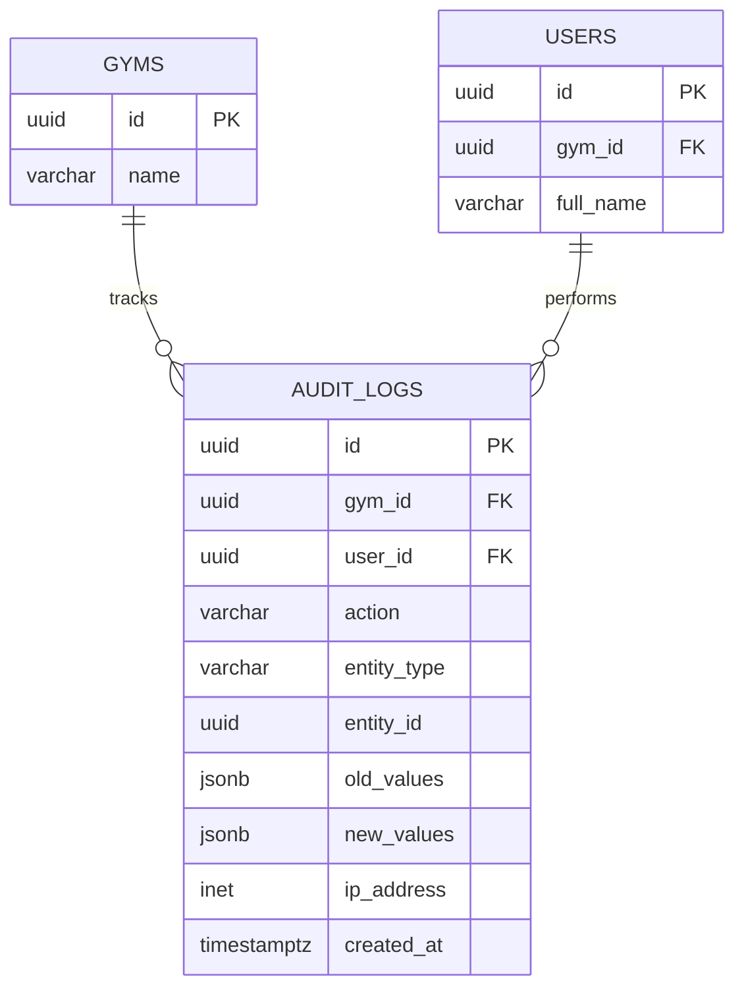

### Relationship Explanation

- One user can generate multiple audit log entries.
- One gym can have multiple audit log entries.
- Audit logs maintain a history of important activities.

---

# 13. Important Relationship Summary

| Parent Entity | Child Entity | Relationship |
|---|---|---|
| Gym | Users | One-to-Many |
| Gym | Staff | One-to-Many |
| User | Staff | One-to-Zero-or-One |
| User | Roles | Many-to-Many |
| Role | Permissions | Many-to-Many |
| Gym | Members | One-to-Many |
| Member | Member Memberships | One-to-Many |
| Membership Plan | Member Memberships | One-to-Many |
| Member Membership | Freeze Periods | One-to-Many |
| Member Membership | Membership Events | One-to-Many |
| Member | Attendance | One-to-Many |
| Member | Payments | One-to-Many |
| Member Membership | Payments | One-to-Many |
| Payment | Refunds | One-to-Many |
| Trainer | Members | Many-to-Many through assignments |
| Trainer | Trainer Attendance | One-to-Many |
| Expense Category | Expenses | One-to-Many |
| Member | Notifications | One-to-Many |
| User | Audit Logs | One-to-Many |

---

# 14. Important Database Design Rules

1. Every gym-owned record must have a `gym_id`.
2. Every table must have a primary key.
3. Foreign keys must be properly defined.
4. Many-to-many relationships must use junction tables.
5. Membership plans must remain separate from member memberships.
6. Payments must remain separate from memberships.
7. Refunds must remain separate from payments.
8. Member records must remain separate from staff login accounts.
9. Roles must be dynamic database records.
10. Permissions must be predefined application records.
11. Historical records must be preserved.
12. Financial records must not be permanently deleted.
13. All financial calculations must use NUMERIC.
14. All gym-owned relationships must enforce gym-level boundaries.
15. Important operations must be recorded in audit logs.

---

# 15. ERD Validation Checklist

Before implementing database migrations, verify:

- [ ] Every entity in `dbDesign.md` appears in the ERD.
- [ ] Every foreign key has a corresponding relationship.
- [ ] Every many-to-many relationship uses a junction table.
- [ ] Every gym-owned table has `gym_id`.
- [ ] RBAC supports custom roles.
- [ ] Staff and members are separate.
- [ ] Membership plans and member memberships are separate.
- [ ] Payments and refunds are separate.
- [ ] Membership history is preserved.
- [ ] Attendance relationships are correct.
- [ ] Trainer assignment history is preserved.
- [ ] Expense categories are connected to expenses.
- [ ] Notification history is preserved.
- [ ] Audit logs are connected to users and gyms.

---

# 16. Final Architecture Decision

The Gym Management System will use a modular relational database design.

Each module will have its own entities and relationships while sharing common entities such as:

- Gyms
- Users
- Staff
- Members
- Audit Logs

The database will initially support one gym but will be structured to support multiple gyms in the future.

**The ERD is the visual reference for database implementation. The detailed column definitions and constraints in `dbDesign.md` remain the source of truth for migrations.**