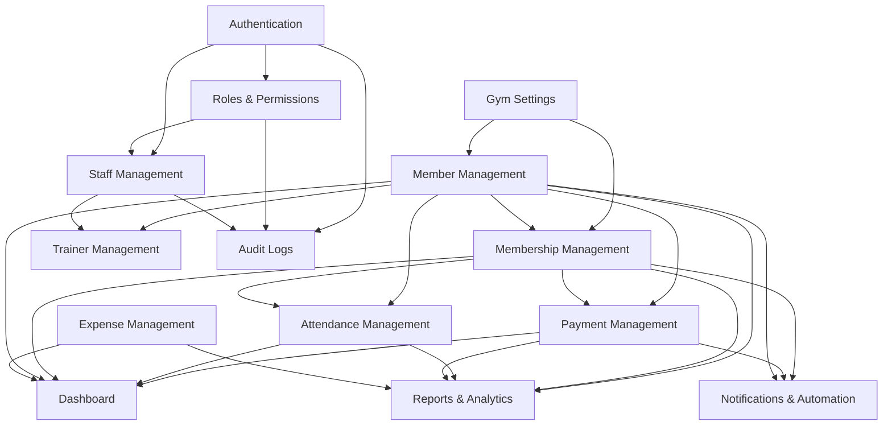

# Module Documentation – Gym Management System

## 1. Purpose

This document describes every module of the Gym Management System.

It defines:
- Module responsibilities.
- Features and functionality.
- Database dependencies.
- API dependencies.
- Business rules.
- Relationships between modules.
- Implementation priorities.

The purpose is to maintain a clear understanding of the application while developing it module by module.

---

# 2. Application Modules Overview

The application will initially contain the following modules:

| No. | Module | Priority |
|---|---|---|
| 1 | Authentication | Critical |
| 2 | Dashboard | High |
| 3 | Member Management | Critical |
| 4 | Membership Management | Critical |
| 5 | Attendance Management | Critical |
| 6 | Payment Management | Critical |
| 7 | Trainer Management | Medium |
| 8 | Expense Management | Medium |
| 9 | Notifications & Automation | Medium |
| 10 | Reports & Analytics | High |
| 11 | Staff Management | High |
| 12 | Roles & Permissions (RBAC) | Critical |
| 13 | Gym Settings | High |
| 14 | Audit Logs | High |

Workout and Diet Management are excluded from the initial MVP.

---

# 3. Authentication Module

## 3.1 Purpose

The Authentication Module manages staff login sessions and protects application access.

Only authorized staff members should be able to access the management system.

Gym members are separate records and do not automatically receive staff login access.

## 3.2 Features

- Staff login.
- Logout.
- Access token management.
- Refresh token management.
- Password hashing.
- Change password.
- Session validation.
- Protected routes.
- Account activation and deactivation checks.

## 3.3 Database Dependencies

- users
- staff

Additional session or refresh-token storage may be introduced depending on the authentication implementation.

## 3.4 API Dependencies

| Method | Endpoint | Purpose |
|---|---|---|
| POST | /auth/login | Login |
| POST | /auth/logout | Logout |
| POST | /auth/refresh | Refresh session |
| GET | /auth/me | Get logged-in user |
| PATCH | /auth/change-password | Change password |

## 3.5 Business Rules

- Only active staff accounts can log in.
- Passwords must be securely hashed.
- Protected APIs require authentication.
- Refresh sessions must be validated.
- Logout must invalidate the relevant refresh session.
- Staff permissions must be checked separately through RBAC.

## 3.6 Dependencies

- Staff Management
- RBAC
- Gym Settings

---

# 4. Dashboard Module

## 4.1 Purpose

The Dashboard provides a quick overview of gym operations.

It should help owners and authorized staff understand the current condition of the gym.

## 4.2 Features

### Statistics Cards

- Total Members.
- Active Members.
- Expired Members.
- Today's Attendance.
- Today's Collection.
- Pending Payments.
- Monthly Revenue.

### Charts

- Monthly Revenue.
- Attendance Overview.
- Membership Growth.
- Payment Collection.

### Recent Activities

- Recently Registered Members.
- Recent Payments.
- Upcoming Membership Expirations.
- Recent Attendance.

## 4.3 Database Dependencies

The Dashboard retrieves data from:

- members
- member_memberships
- attendance
- payments
- refunds
- expenses

## 4.4 API Dependencies

| Method | Endpoint | Purpose |
|---|---|---|
| GET | /dashboard/overview | Dashboard statistics |
| GET | /dashboard/revenue | Revenue chart data |
| GET | /dashboard/attendance | Attendance chart data |
| GET | /dashboard/membership-growth | Membership growth |
| GET | /dashboard/recent-activities | Recent activities |

## 4.5 Business Rules

- Statistics must follow the gym's configured timezone.
- Active members and active memberships must be counted separately.
- Failed payments must not count as collections.
- Refunds must be accounted for separately.
- Pending expenses must not be included in paid expenses.
- Dashboard data must respect the logged-in user's permissions.

## 4.6 Dependencies

- Members
- Memberships
- Attendance
- Payments
- Expenses
- Reports

---

# 5. Member Management Module

## 5.1 Purpose

The Member Management Module manages gym customers and their personal information.

A member can exist without having an active membership.

## 5.2 Features

- Register new member.
- View member list.
- View member profile.
- Update member information.
- Activate member.
- Deactivate member.
- Search members.
- Filter members.
- Upload profile picture.
- View membership history.
- View payment history.
- View attendance history.

## 5.3 Member Information

- Member ID.
- Full Name.
- Mobile Number.
- Email.
- Gender.
- Date of Birth.
- Address.
- Emergency Contact.
- Joining Date.
- Profile Picture.
- Account Status.

## 5.4 Database Dependencies

- members
- member_memberships
- payments
- attendance
- member_qr_tokens
- membership_events

## 5.5 API Dependencies

| Method | Endpoint | Purpose |
|---|---|---|
| GET | /members | Get members |
| POST | /members | Create member |
| GET | /members/:id | Get member details |
| PUT | /members/:id | Update member |
| PATCH | /members/:id/status | Update member status |
| GET | /members/:id/memberships | Membership history |
| GET | /members/:id/payments | Payment history |
| GET | /members/:id/attendance | Attendance history |

## 5.6 Business Rules

- Every member must have a unique member ID within the gym.
- Member account status is separate from membership status.
- Deactivating a member must not delete their history.
- Duplicate mobile numbers must follow the gym's configured uniqueness policy.
- Member deletion should follow the application's retention policy.
- Member records must not be accessible to unauthorized staff.

## 5.7 Dependencies

- Membership Management
- Payment Management
- Attendance Management
- Notifications

---

# 6. Membership Management Module

## 6.1 Purpose

The Membership Management Module manages membership plans and individual member subscriptions.

It handles membership assignment, renewal, expiry, freezing, and extension.

Membership plans and member memberships must be maintained separately.

## 6.2 Features

### Membership Plans

- Create membership plan.
- Update membership plan.
- Activate/deactivate plan.
- Set duration.
- Set price.
- View plan list.

### Member Memberships

- Assign membership.
- Renew membership.
- Freeze membership.
- Unfreeze membership.
- Extend membership.
- Cancel membership.
- View membership history.
- Track membership expiry.

## 6.3 Database Dependencies

- membership_plans
- member_memberships
- membership_freeze_periods
- membership_events
- members
- payments

## 6.4 API Dependencies

| Method | Endpoint | Purpose |
|---|---|---|
| GET | /membership-plans | Get plans |
| POST | /membership-plans | Create plan |
| GET | /membership-plans/:id | Plan details |
| PUT | /membership-plans/:id | Update plan |
| PATCH | /membership-plans/:id/status | Update plan status |
| GET | /memberships | Get memberships |
| POST | /memberships | Assign membership |
| GET | /memberships/:id | Membership details |
| POST | /memberships/:id/renew | Renew membership |
| POST | /memberships/:id/freeze | Freeze membership |
| POST | /memberships/:id/unfreeze | Unfreeze membership |
| POST | /memberships/:id/extend | Extend membership |
| POST | /memberships/:id/cancel | Cancel membership |
| GET | /memberships/:id/events | Membership history |

## 6.5 Business Rules

- A member can have multiple historical memberships.
- A new renewal must create a new membership record.
- Previous membership history must remain unchanged.
- Membership end dates are inclusive.
- Membership status must follow the defined date and lifecycle rules.
- Freezing must create a separate freeze period record.
- Plan price changes must not modify historical membership prices.
- The backend must calculate or validate membership amounts.
- Attendance eligibility must be based on membership rules.

## 6.6 Dependencies

- Member Management
- Payment Management
- Attendance Management
- Notifications
- Dashboard
- Reports

---

# 7. Attendance Management Module

## 7.1 Purpose

The Attendance Module tracks member check-ins and check-outs.

It ensures only eligible members can access gym facilities.

## 7.2 Features

- Manual check-in.
- QR check-in.
- Check-out.
- Member search.
- Daily attendance list.
- Attendance history.
- Attendance filters.
- Attendance reports.

## 7.3 Database Dependencies

- attendance
- members
- member_memberships
- member_qr_tokens
- users

## 7.4 API Dependencies

| Method | Endpoint | Purpose |
|---|---|---|
| GET | /attendance | Get attendance records |
| POST | /attendance/check-in | Manual check-in |
| POST | /attendance/check-out | Check-out |
| POST | /attendance/qr-check-in | QR check-in |
| GET | /attendance/:id | Attendance details |
| GET | /attendance/member/:memberId | Member attendance |
| GET | /attendance/summary | Attendance summary |

## 7.5 Business Rules

- Only eligible members can check in.
- Inactive members cannot check in.
- Members with expired memberships cannot check in.
- Frozen memberships cannot check in.
- Duplicate check-ins must be prevented according to the attendance policy.
- QR tokens must be validated securely.
- Only token hashes should be stored.
- Attendance timestamps must be interpreted using the gym timezone.

## 7.6 Dependencies

- Member Management
- Membership Management
- Authentication
- RBAC
- Dashboard
- Reports

---

# 8. Payment Management Module

## 8.1 Purpose

The Payment Module manages money collected from gym members.

It supports full payments, partial payments, outstanding dues, receipts, and refunds.

## 8.2 Features

- Collect payment.
- Partial payment.
- Payment history.
- Payment details.
- Receipt generation.
- Payment method tracking.
- Pending dues.
- Refund management.
- Payment reports.

## 8.3 Supported Payment Methods

- Cash.
- UPI.
- Card.
- Bank Transfer.
- Other configured methods.

## 8.4 Database Dependencies

- payments
- refunds
- members
- member_memberships
- users

## 8.5 API Dependencies

| Method | Endpoint | Purpose |
|---|---|---|
| GET | /payments | Get payments |
| POST | /payments | Create payment |
| GET | /payments/:id | Payment details |
| GET | /payments/:id/receipt | Generate receipt |
| POST | /payments/:id/refund | Create refund |
| GET | /payments/member/:memberId | Member payment history |
| GET | /payments/pending | Pending dues |
| GET | /payments/summary | Collection summary |

## 8.6 Business Rules

- Payments must be associated with the correct member.
- Payments should be linked to a membership when collecting membership dues.
- Partial payments are supported.
- Failed payments must not count as successful collections.
- Successful refunds must be recorded separately.
- Refunds must not modify the original payment record.
- Receipt numbers must be unique within the gym.
- Refunds require appropriate permissions.
- Financial calculations must use decimal-safe database types.
- Important payment operations must use database transactions.

## 8.7 Dependencies

- Member Management
- Membership Management
- RBAC
- Dashboard
- Reports
- Notifications

---

# 9. Trainer Management Module

## 9.1 Purpose

The Trainer Module manages gym trainers and their relationships with members.

## 9.2 Features

- Add trainer.
- Update trainer.
- Activate/deactivate trainer.
- View trainer details.
- Assign members.
- Remove member assignments.
- View assigned members.
- Record trainer attendance.
- View trainer attendance history.

## 9.3 Trainer Information

- Trainer ID.
- Full Name.
- Mobile Number.
- Email.
- Specialization.
- Joining Date.
- Salary.
- Status.

## 9.4 Database Dependencies

- trainers
- trainer_member_assignments
- trainer_attendance
- staff
- members

## 9.5 API Dependencies

| Method | Endpoint | Purpose |
|---|---|---|
| GET | /trainers | Get trainers |
| POST | /trainers | Create trainer |
| GET | /trainers/:id | Trainer details |
| PUT | /trainers/:id | Update trainer |
| PATCH | /trainers/:id/status | Update status |
| POST | /trainers/:id/members | Assign members |
| GET | /trainers/:id/members | Get assigned members |
| GET | /trainers/:id/attendance | Trainer attendance |

## 9.6 Business Rules

- Trainer records should preserve historical assignments.
- A trainer may be linked to a staff login account.
- A trainer should only access assigned members when record-level restrictions are enabled.
- Trainer attendance must be stored separately from member attendance.
- Salary expenses should be recorded when actually paid, not automatically duplicated.

## 9.7 Dependencies

- Member Management
- Staff Management
- Expense Management
- Attendance
- RBAC

---

# 10. Expense Management Module

## 10.1 Purpose

The Expense Module tracks money spent on gym operations.

It helps gym owners understand operating costs.

## 10.2 Features

- Create expense.
- Update expense.
- View expenses.
- Delete or void expense according to policy.
- Create expense categories.
- Filter expenses.
- View expense reports.

## 10.3 Example Expense Categories

- Rent.
- Electricity.
- Water.
- Trainer Salary.
- Staff Salary.
- Equipment.
- Maintenance.
- Marketing.
- Cleaning.
- Other Expenses.

## 10.4 Database Dependencies

- expenses
- expense_categories
- users

## 10.5 API Dependencies

| Method | Endpoint | Purpose |
|---|---|---|
| GET | /expenses | Get expenses |
| POST | /expenses | Create expense |
| GET | /expenses/:id | Expense details |
| PUT | /expenses/:id | Update expense |
| PATCH | /expenses/:id/status | Update expense status |
| GET | /expense-categories | Get categories |
| POST | /expense-categories | Create category |
| GET | /expenses/summary | Expense summary |

## 10.6 Business Rules

- Expense amount must be positive.
- Every expense should have a valid category.
- Pending expenses should not count as paid expenses.
- Paid expenses should contribute to operating expense reports.
- Expense changes should be auditable.
- Voided expenses should be excluded from financial totals.
- Salary payments must not be recorded twice.

## 10.7 Dependencies

- Dashboard
- Reports
- Staff Management
- RBAC

---

# 11. Notifications & Automation Module

## 11.1 Purpose

The Notification Module sends important updates to members and staff.

Automation handles scheduled tasks such as membership expiry checks.

## 11.2 Features

- Welcome notification.
- Membership expiry notification.
- Membership expired notification.
- Payment received notification.
- Pending payment notification.
- Birthday notification.
- In-app notification center.
- Email notifications.
- WhatsApp notifications.
- Notification templates.
- Retry failed notifications.

## 11.3 Database Dependencies

- notifications
- notification_templates
- members
- member_memberships
- payments
- users

## 11.4 API Dependencies

| Method | Endpoint | Purpose |
|---|---|---|
| GET | /notifications | Get notifications |
| PATCH | /notifications/:id/read | Mark as read |
| PATCH | /notifications/read-all | Mark all as read |
| GET | /notification-templates | Get templates |
| POST | /notification-templates | Create template |
| PUT | /notification-templates/:id | Update template |

## 11.5 Business Rules

- Notifications should be generated based on business events or scheduled jobs.
- Notification failure must not undo a successful business operation.
- Failed notifications should be logged.
- Retry attempts should follow a configured policy.
- Duplicate notifications should be prevented.
- Notification templates should support reusable placeholders.
- External provider credentials must not be exposed to the frontend.

## 11.6 Dependencies

- Members
- Memberships
- Payments
- Authentication
- Background Jobs
- Gym Settings

---

# 12. Reports & Analytics Module

## 12.1 Purpose

The Reports Module provides information about gym performance and business operations.

## 12.2 Features

- Daily revenue report.
- Monthly revenue report.
- Expense report.
- Active member report.
- Expired member report.
- Membership renewal report.
- Attendance report.
- Payment collection report.
- Export reports.

## 12.3 Database Dependencies

- members
- member_memberships
- attendance
- payments
- refunds
- expenses
- expense_categories

## 12.4 API Dependencies

| Method | Endpoint | Purpose |
|---|---|---|
| GET | /reports/revenue | Revenue report |
| GET | /reports/expenses | Expense report |
| GET | /reports/members | Member report |
| GET | /reports/memberships | Membership report |
| GET | /reports/attendance | Attendance report |
| GET | /reports/payments | Payment report |
| GET | /reports/export | Export report |

## 12.5 Business Rules

- Reports must use the selected date range.
- Date filters must follow the gym timezone.
- Failed payments must be excluded from collections.
- Refunds must be calculated separately.
- Paid expenses and pending expenses must be distinguished.
- Financial reports must distinguish sales, collections, refunds, and outstanding dues.
- Report access and export access must be permission-controlled.

## 12.6 Dependencies

- Members
- Memberships
- Attendance
- Payments
- Expenses
- RBAC

---

# 13. Staff Management Module

## 13.1 Purpose

The Staff Module manages employees who can access the Gym Management System.

Staff users are different from gym members.

## 13.2 Features

- Add staff.
- Update staff information.
- Activate/deactivate staff.
- Assign roles.
- Remove roles.
- View staff details.
- View assigned permissions.

## 13.3 Staff Information

- Staff ID.
- Full Name.
- Email.
- Mobile.
- Designation.
- Joining Date.
- Status.
- Assigned Roles.

## 13.4 Database Dependencies

- users
- staff
- roles
- user_roles

## 13.5 API Dependencies

| Method | Endpoint | Purpose |
|---|---|---|
| GET | /staff | Get staff |
| POST | /staff | Create staff |
| GET | /staff/:id | Staff details |
| PUT | /staff/:id | Update staff |
| PATCH | /staff/:id/status | Activate/deactivate |
| POST | /staff/:id/roles | Assign roles |
| GET | /staff/:id/roles | Get assigned roles |

## 13.6 Business Rules

- Staff login accounts must be separate from gym member records.
- Only authorized users can create or modify staff.
- Inactive staff cannot log in.
- Multiple roles can be assigned to a staff user.
- Role assignment changes must be audited.
- The last active owner must not lose critical owner access.

## 13.7 Dependencies

- Authentication
- RBAC
- Audit Logs

---

# 14. Roles & Permissions Module

## 14.1 Purpose

The RBAC Module manages dynamic roles and permissions.

The gym owner should be able to create custom roles according to staff responsibilities.

## 14.2 Features

- View permission catalogue.
- Create custom role.
- Update role.
- Delete unused role.
- Assign permissions to roles.
- Assign roles to staff.
- Remove roles from staff.
- Calculate effective permissions.

## 14.3 Example Roles

- Owner.
- Administrator.
- Receptionist.
- Accountant.
- Trainer.
- Custom Roles.

These are default role templates, not hardcoded authorization logic.

## 14.4 Example Permissions

**Members**
- members.view
- members.create
- members.update
- members.delete

**Memberships**
- memberships.view
- memberships.create
- memberships.renew
- memberships.freeze

**Payments**
- payments.view
- payments.create
- payments.refund

**Reports**
- reports.view
- reports.export

## 14.5 Database Dependencies

- roles
- permissions
- role_permissions
- user_roles
- users
- staff

## 14.6 API Dependencies

| Method | Endpoint | Purpose |
|---|---|---|
| GET | /permissions | Get permission catalogue |
| GET | /roles | Get roles |
| POST | /roles | Create role |
| GET | /roles/:id | Role details |
| PUT | /roles/:id | Update role |
| DELETE | /roles/:id | Delete role |
| GET | /roles/:id/permissions | Get role permissions |
| PUT | /roles/:id/permissions | Update role permissions |

## 14.7 Business Rules

- Permission keys must come from a predefined application catalogue.
- Owners can create custom role combinations.
- A role can contain multiple permissions.
- A staff user can have multiple roles.
- Effective permissions are the union of permissions from active assigned roles.
- Backend authorization is mandatory.
- Frontend permission checks are for UI convenience only.
- Assigned roles cannot be deleted without first handling their assignments.
- Protected system roles cannot be deleted.
- Trainer record-level restrictions must be checked separately from module permissions.

## 14.8 Dependencies

- Authentication
- Staff Management
- All protected modules

---

# 15. Gym Settings Module

## 15.1 Purpose

The Gym Settings Module stores configuration information for the gym.

It also prepares the application for future SaaS conversion.

## 15.2 Features

### Gym Profile
- Gym Name.
- Logo.
- Address.
- Contact Number.
- Email.

### General Settings
- Currency.
- Timezone.
- Date Format.
- Default Membership Settings.
- Attendance Settings.

### Notification Settings
- Email preferences.
- WhatsApp preferences.
- Notification templates.

### Future SaaS Settings
- Organization information.
- Subscription information.
- Plan limits.
- Feature access.

## 15.3 Database Dependencies

- gyms
- gym_settings

## 15.4 API Dependencies

| Method | Endpoint | Purpose |
|---|---|---|
| GET | /gym/profile | Get gym profile |
| PUT | /gym/profile | Update gym profile |
| GET | /gym/settings | Get settings |
| PUT | /gym/settings | Update settings |

## 15.5 Business Rules

- Gym settings must belong to the correct gym.
- Currency and timezone must be configured correctly.
- Settings must be validated on the backend.
- Sensitive provider credentials must be stored securely.
- Users can only modify settings with appropriate permissions.

## 15.6 Dependencies

- Authentication
- RBAC
- All modules that use gym-level configuration

---

# 16. Audit Logs Module

## 16.1 Purpose

The Audit Logs Module records important activities performed by staff users.

It helps gym owners understand who performed an action and when it happened.

## 16.2 Features

- View audit logs.
- Filter by staff.
- Filter by module.
- Filter by action.
- Filter by date.
- View record-level activity.

## 16.3 Events to Record

- Member created.
- Member updated.
- Member deactivated.
- Membership assigned.
- Membership renewed.
- Payment created.
- Refund created.
- Expense created.
- Staff created.
- Staff deactivated.
- Role created.
- Role permissions changed.
- Role assigned or removed.

## 16.4 Database Dependencies

- audit_logs
- users
- staff

## 16.5 API Dependencies

| Method | Endpoint | Purpose |
|---|---|---|
| GET | /audit-logs | Get audit logs |
| GET | /audit-logs/:id | Get audit log details |

## 16.6 Business Rules

- Audit logs should record the acting user.
- Important changes should include the affected entity.
- Logs should include timestamps.
- Sensitive credentials and tokens must never be logged.
- Ordinary staff should not be able to modify audit records.
- Audit access must be permission-controlled.

## 16.7 Dependencies

- Authentication
- RBAC
- All modules performing important operations

---

# 17. Module Dependency Overview

Modules depend on one another.

The following diagram represents the major relationships:

---

# 18. Recommended Development Order

Build the modules in a dependency-aware order.

### Phase 1: Foundation

1. Project Setup.
2. Database Setup.
3. Gym Settings Foundation.
4. Authentication.
5. RBAC.
6. Staff Management.
7. Audit Logging Foundation.

### Phase 2: Core Gym Operations

8. Member Management.
9. Membership Plans.
10. Member Memberships.
11. Payment Management.
12. Attendance Management.

### Phase 3: Business Operations

13. Trainer Management.
14. Expense Management.
15. Notifications & Automation.

### Phase 4: Management and Analytics

16. Dashboard.
17. Reports & Analytics.

### Phase 5: Quality and Deployment

18. Automated Testing.
19. Security Testing.
20. Performance Testing.
21. Deployment.
22. Backup and Monitoring.

This order may be adjusted when implementation dependencies require it.

---

# 19. Module Development Rules

Follow these rules while developing each module:

1. Understand the module's requirements before coding.
2. Read its relevant business rules.
3. Review the database design.
4. Review the ER diagram.
5. Review API design.
6. Check RBAC permissions.
7. Implement backend logic.
8. Implement API validation.
9. Write unit and integration tests.
10. Implement frontend pages.
11. Connect frontend APIs.
12. Test complete user workflows.
13. Update project documentation.
14. Update project progress.

### Important Development Principle

Do not put all business logic inside API route handlers.

Keep responsibilities separated:

- Routes: Define API endpoints.
- Controllers: Handle HTTP requests and responses.
- Services: Contain business logic.
- Repositories or data-access layer: Handle database operations where this pattern is used.
- Validators: Validate request input.
- Middleware: Handle authentication, authorization, and common request processing.

Use database transactions for operations that modify multiple related records.

---

# 20. AI Coding Agent Instructions

When assigning a module to an AI coding agent, follow these instructions:

1. Read `prd.md`.
2. Read `mvpScope.md`.
3. Read `businessRules.md`.
4. Read `dbDesign.md`.
5. Read `erDiagram.md`.
6. Read `apiDesign.md`.
7. Read `rbac.md`.
8. Read this `moduleDocumentation.md`.
9. Read the relevant module-specific requirements.
10. Inspect the existing project structure before modifying files.

### Agent Rules

- Do not change unrelated modules.
- Do not create duplicate database tables.
- Follow the existing database schema.
- Follow the existing API conventions.
- Use predefined permission keys.
- Validate all API inputs.
- Enforce permissions on the backend.
- Use transactions for important multi-record operations.
- Write tests for implemented features.
- Reuse existing UI components.
- Do not redesign the application without permission.
- Update documentation when requirements or implementation decisions change.

If an important requirement is missing or contradictory, identify it before implementing a potentially destructive change.

---

# 21. Final Architecture Principle

Every module should have a clear responsibility and communicate with other modules through well-defined interfaces.

The system should remain a modular monolith initially.

This means:
- One backend application.
- One primary PostgreSQL database.
- Separate modules for business functionality.
- Clear boundaries between modules.
- Shared authentication and authorization.
- Reusable services and utilities.
- No unnecessary microservices.

The architecture should make future SaaS conversion possible without introducing SaaS complexity before it is needed.

**Final Goal:** Build a modular, maintainable, secure, and production-ready Gym Management System that can initially serve one gym and later evolve into a multi-tenant SaaS product.